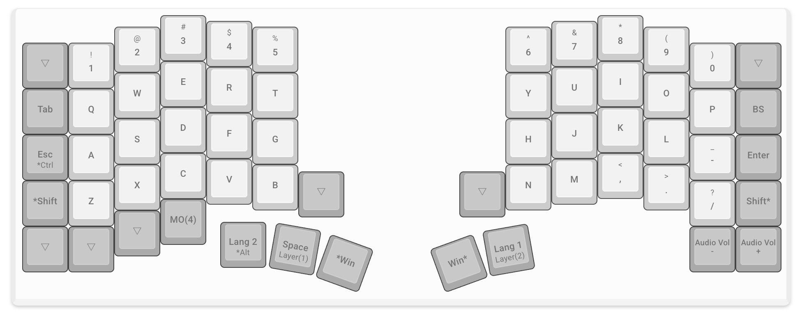
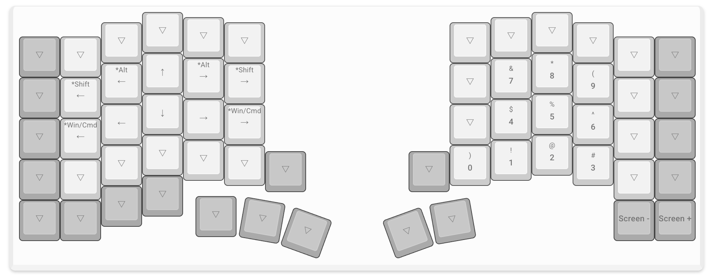
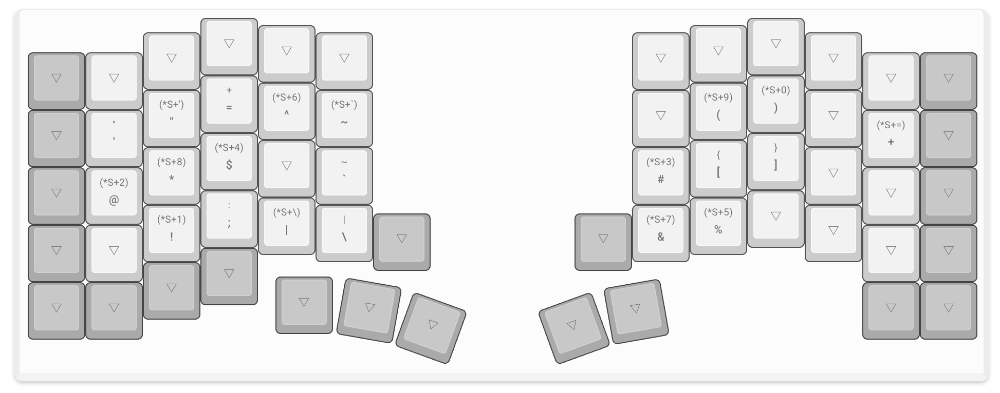
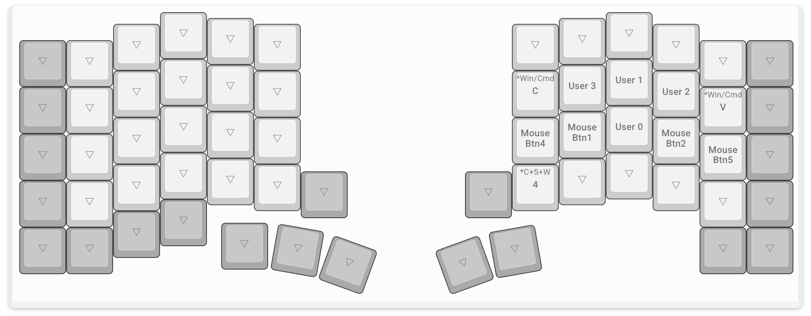
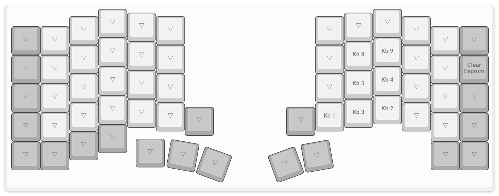

# Keyball61 の使い方

## 1. Keyball61 とは

このドキュメントは、Keyball61 を初めて使う人に向けて、このキーボードの使い方と設定をまとめたものです。キーの配置は Mac で使う前提で作ってあります。

### 1-1. 分割キーボード

**Keyball61** は、左手用と右手用の2つに分かれた **分割キーボード** です。右手側には、指で転がしてマウスカーソルを動かす **トラックボール** がついています。

左右は **TRRS ケーブル**（4極のイヤホンジャックケーブル）でつなぎます。パソコンとは、どちらか片方を USB ケーブルでつなぎます。

### 1-2. つなぎ方

キーボードは、次の順番でつなぎます。

1. TRRS ケーブルで左右をつなぐ
2. USB ケーブルで、左右のどちらか片方をパソコンにつなぐ

USB ケーブルは、毎回同じ側に差してください。理由は後述の [2-2. EEPROM](#2-2-eeprom) で説明します。

> [!WARNING]
> **TRRS ケーブルの抜き差し**
> 
> USB ケーブルをパソコンにつないだまま TRRS ケーブルを抜き差しすると、キーボードの中の **マイコンが壊れることがあります。** TRRS ケーブルを抜き差しするときは、**必ず先に USB ケーブルを抜いてください!!**

## 2. 設定の仕組み

キーボードの設定は、キーボードの中の2つの場所に分かれて保存されています。どこに何が保存されているかを知っておくと、設定を変えたときの動きがわかりやすくなります。

### 2-1. ファームウェア

**ファームウェア** は、キーボードの中のマイコン（小さなコンピューター）で動いているプログラムです。最初のキー配置や、カスタマイズキーを押したときの動き（たとえば、後述のスクロールキーの動き）は、ファームウェアに書かれています。

ファームウェアの内容を変えるには、パソコンでファームウェアを作り直して、キーボードに書き込み直す必要があります（[9. ファームウェアの書き込み](#9-ファームウェアの書き込み)）。

ファームウェアを入れておける容量は 28,672 バイトで、今のファームウェアはその 94% を使っています。そのため、これ以上大きな機能を足すことはほとんどできません。

### 2-2. EEPROM

**EEPROM** （イーイーピーロム）は、キーボードの中にある、電源を切っても内容が消えないメモリです。 容量は 1,024 バイトで、次の2つが保存されます。

- **キー配置**
    - 後述の Remap で変えたキー配置
- **トラックボールの設定**
    - カーソルの速さなど、後述の設定キーで変えて保存した値

EEPROM にキー配置が保存されているときは、ファームウェアのキー配置ではなく、 **EEPROM のキー配置が使われます** 。

EEPROM は左右のマイコンに1つずつあり、キーボードは USB ケーブルを差した側の EEPROM を使います。USB ケーブルを差す側を変えると、もう片方の EEPROM に保存された別のキー配置で動くことがあります。これが、USB ケーブルを毎回同じ側に差す理由です。

## 3. レイヤーの仕組み

### 3-1. レイヤーとは

**レイヤー** は、決まったキーを押している間だけ、キーボード全体のキー配置を切り替える仕組みです。たとえば、左手の親指で Space キーを押している間は、右手の U・I・O のキーで 7・8・9 が入力されるようになります。

Keyball61 はキーの数が普通のキーボードより少ないので、数字や記号はレイヤーを切り替えて入力します。

### 3-2. レイヤーの一覧

このキーボードには、レイヤーが5つあります。

| レイヤー | 役割    | 入り方                  |
| ---- | ----- | -------------------- |
| 0    | 文字入力  | 何も押していないとき           |
| 1    | 数字と移動 | 左手の親指の Space を押している間 |
| 2    | 記号    | 右手の親指のかなキーを押している間    |
| 3    | マウス   | トラックボールを動かしたとき       |
| 4    | 設定    | 左手の C の下のキーを押している間   |

このドキュメントの配置図は、後述の Remap の画面を写したものです。図の中の表示は、次のように読みます。

- **`▽`**
    - レイヤー1〜4 では、レイヤー0 と同じキーが入力されることを表します
    - レイヤー0 では、押しても何も入力されないことを表します
- **`Win`**
    - Mac の Cmd キーです
- **`Alt`**
    - Mac の Option キーです
- **`Lang 2` と `Lang 1`**
    - `Lang 2` は英数キー、`Lang 1` はかなキーです
- **`*` のついた表示**
    - 修飾キー（Cmd・Shift・Ctrl・Option）を表します
    - たとえば `Esc *Ctrl` はタップで Esc、ホールドで Ctrl になるキー、`*Win/Cmd C` は Cmd + C を送るキーです

## 4. 文字入力のレイヤー

### 4-1. キーの配置

何も押していないときのキー配置（レイヤー0）は、次のとおりです。

アルファベットの並びは、普通のキーボードと同じです。普通のキーボードと違う点は、次の3つです。

- **A の左（`Esc *Ctrl`）**
    - Esc と Ctrl を兼ねたキーです（次のセクションで説明）
- **何も入力されないキー（`▽`）**
    - 左下の3つ、一番上の段の左右の端、B の右隣と N の左隣は、何も入力されません
- **一番上の数字の段**
    - 数字はレイヤー1 でも入力できるので、一番上の段は使わなくてもすべての操作ができます
    - この段は、あとでもっとキーの少ないキーボードに移ることを考えて、補助として置いているだけです

### 4-2. タップとホールド

キーを押してから 0.2 秒以内に離すことを **タップ** 、0.2 秒より長く押し続けることを **ホールド** といいます。いくつかのキーは、タップしたときとホールドしたときで、別の動きをします。

このしくみのキーは、次の4つです。

| キー | タップしたとき | ホールドしたとき |
| --- | --- | --- |
| A の左 | Esc | Ctrl |
| 左手の親指の英数キー | 英数 | Option |
| 左手の親指の `Space` | スペース | レイヤー1 |
| 右手の親指のかなキー | かな | レイヤー2 |

基本的に **ホールドと判定されるかどうかは、そのキーを 0.2 秒押し続けたかどうかだけで決まります。** ほかのキーを押したタイミングは関係ありません。

たとえば Space を押してすぐ U を押し、0.2 秒経たないうちに Space を離すと、Space はタップと判定されます。この場合は `7` ではなく、スペースと `u` が入力されます。反対に、U を押すのが早くても、Space を 0.2 秒以上押したままにしていれば、Space はホールドと判定され、`7` が入力されます。

素早く打つと、Space を 0.2 秒押し続ける前に離してしまいがちです。数字や記号を入力するときは、Space やかなキーを気持ち長めに押したままにしてください。

ただし **A の左のキーだけは、押しながらほかのキーを押した時点で、すぐに Ctrl になります。** Ctrl + C のようなショートカットを素早く打てるようにするためです。

また、スペースを連続で入力したいときは、**Space をタップしてから 0.2 秒以内にもう一度押し、そのままホールドしてください。** これにより、space キーを押しっぱなしにするのと同じになります。

### 4-3. 親指キー

親指で押すキーは、左手に3つ、右手に2つあります。

- **左手**
    - 英数キー（`Lang 2`）：タップすると英数、ホールドすると Option
    - `Space`：タップするとスペース、ホールドするとレイヤー1（数字と移動）
    - `Win`：Cmd キー
- **右手**
    - `Win`：Cmd キー
    - かなキー（`Lang 1`）：タップするとかな、ホールドするとレイヤー2（記号）

日本語入力と英語入力の切り替えは、英数キーとかなキーで行います。英数キーを押すと英語入力に、かなキーを押すと日本語入力になります。

右下の2つのキー（`Audio Vol -` と `Audio Vol +`）は、音量を下げるキーと上げるキーです。

## 5. 数字と記号

### 5-1. 数字と移動

左手の親指で Space を押している間（レイヤー1）のキー配置は、次のとおりです。

右手には、電卓のテンキーと同じ並びで数字があります。N の段が 0〜3、J の段が 4〜6、U の段が 7〜9 です。

左手には、カーソルを動かすキーがあります。

- **E・S・D・F**
    - 上・左・下・右の矢印キーです
- **W と R（`*Alt ←`・`*Alt →`）**
    - Option + ← と Option + → です
    - カーソルが単語単位で左右に動きます
- **A と G（`*Win/Cmd ←`・`*Win/Cmd →`）**
    - Cmd + ← と Cmd + → です
    - カーソルが行の先頭と末尾に動きます
- **Q と T（`*Shift ←`・`*Shift →`）**
    - Shift + ← と Shift + → です
    - 1文字ずつ選択が広がります

右下の2つのキー（`Screen -` と `Screen +`）は、画面を暗くするキーと明るくするキーです。

### 5-2. 記号

右手の親指でかなキーを押している間（レイヤー2）のキー配置は、次のとおりです。

記号の位置は、記号の英語の呼び名の頭文字などで決めてあります。

| キー | 記号 | 覚え方 |
| --- | --- | --- |
| Q | `'` | quote |
| W | `"` | w-quote（2つの quote） |
| E | `=` | equal |
| R | `^` | raised to the power of（累乗） |
| T | `~` | tilde |
| A | `@` | at |
| S | `*` | star |
| D | `$` | dollar |
| G | `` ` `` | grave |
| X | `!` | eXclamation |
| C | `:` | colon |
| V | `\|` | vertical bar |
| B | `\` | backslash |
| H | `#` | hash |
| N | `&` | 'n（and） |
| L | `+` | large（大きい） |
| P | `%` | percent |

U・I には丸かっこ `( )`、J・K には角かっこ `[ ]` があります。

> [!NOTE]
> **`:` と `;` のキー**
>
> C のキーは、そのまま押すと `:`、Shift を押しながら押すと `;` になります。普通のキーボードとは、Shift の有無と記号の関係が逆です。
> この入れ替えはファームウェアで行っています。そのため、Remap の画面ではこのキーが `;` と表示されますが、実際にそのまま押すと `:` が入力されます。

## 6. トラックボール

### 6-1. マウスのレイヤー

トラックボールを動かすと、キーボードは自動でマウスのレイヤー（レイヤー3）に入ります。このように自動で入るレイヤーを **オートマウスレイヤー** といいます。マウスのレイヤーでは、右手のキーでクリックやスクロールができます。

マウスのレイヤーから抜けるのは、次のどちらかのときです。

- トラックボールを止めてから 10 秒たったとき
- マウスのレイヤーに割り当てていないキー（たとえば A）を押したとき
    - そのキーの文字は、そのまま入力されます

マウスのレイヤーのキーのうち、クリック・戻る・進む・スクロールのキーを押すと、10 秒を数え直します。コピー・ペースト・スクリーンショットのキーは、押してもマウスのレイヤーから抜けませんが、10 秒は数え直しません。

> [!NOTE]
> **確実にマウスのレイヤーから抜けるコツ**
> 
> マウスを使ったあとすぐに J や K などを打つと、文字ではなくクリックやスクロールになることがあります。マウスのレイヤーに入ったままになっているからです。文字を打つ前に **英数キーかかなキーをタップ** すると、マウスのレイヤーから確実に抜けられます。入力モードも一緒に決められます。

### 6-2. クリックとスクロール

マウスのレイヤーのキー配置は、次のとおりです。

| キー | 表示 | 動き |
| --- | --- | --- |
| J | `Mouse Btn1` | 左クリック |
| L | `Mouse Btn2` | 右クリック |
| H | `Mouse Btn4` | ブラウザなどで前のページに戻る |
| `-` | `Mouse Btn5` | ブラウザなどで次のページに進む |
| K | `User 0` | 上へスクロール |
| I | `User 1` | 下へスクロール |
| O | `User 2` | 左へスクロール |
| U | `User 3` | 右へスクロール |
| Y | `*Win/Cmd C` | コピー（Cmd + C） |
| P | `*Win/Cmd V` | ペースト（Cmd + V） |
| N | `*C+S+W 4` | 範囲を選んでクリップボードに保存するスクリーンショット（Cmd + Shift + Ctrl + 4） |

J を押したままトラックボールを動かすと、ドラッグになります。

K・I・U・O の **スクロールキー** は、タップすると決まった量だけスクロールし、ホールドすると、離すまでスクロールし続けます。スクロールの向きは、Mac の「ナチュラルなスクロール」の設定によって逆になります。

J と K を同時に押している間は、トラックボールを動かすと、カーソルではなく画面がスクロールします。「同時」とは、2つのキーを 0.05 秒以内に押すことです。

> [!NOTE]
> **スクロールキーと Remap**
> 
> スクロールキーは、Remap の画面では `User 0`（K）・`User 1`（I）・`User 2`（O）・`User 3`（U）と表示されます。スクロールの動きはファームウェアで作っているので、Remap でスクロールの速さは変えられません。速さを変えたいときは、Mac の「システム設定」の「マウス」にある「スクロールの速さ」で調整してください。ただし、この設定は Mac につないでいる **すべてのマウス** に効くので、ほかのマウスのスクロールの速さも一緒に変わります。
>
> また、J と K の同時押しは、キーの場所ではなく、左クリックと `User 0` の2つのキーの組み合わせで決まっています。Remap でどちらかのキーをマウスのレイヤーから消すと、この同時押しも使えなくなります。

## 7. 設定のレイヤー

### 7-1. レイヤーの入り方

設定のレイヤー（レイヤー4）は、トラックボールの速さなどを変えるためのレイヤーです。左手の C の下のキー（`MO(4)`）を押している間だけ入ります。左手の親指でこのキーを押したまま、右手で設定キーを押します。

> [!NOTE]
> **設定のレイヤーでのスクロール**
> 
> 設定のレイヤーにいる間は、トラックボールを動かすと、カーソルではなく画面がスクロールします。ただし、このレイヤーはスクロールするためのものではありません。普段のスクロールは、マウスのレイヤーのスクロールキーと、J と K の同時押しで行う想定です。
> スクロール専用のレイヤーを作らず、設定のレイヤーと兼用しているのは、EEPROM の容量を節約するためです。レイヤーを1つ増やすと、Remap のキー配置を保存するために EEPROM を 160 バイト使います。今の5つのレイヤーで、1,024 バイトのうち 800 バイトを使っています。

### 7-2. 設定キー

設定のレイヤーのキー配置は、次のとおりです。

右手には、トラックボールの設定を変えるキーが並んでいます。`Kb 1` のような名前は、Remap でこのキーを表示するときの名前です。

| キー | 名前 | 動き |
| --- | --- | --- |
| N | Kb 1 | トラックボールの設定を EEPROM に保存する |
| M | Kb 2 | カーソルを少し速くする（CPI + 100） |
| `,` | Kb 3 | カーソルを少し遅くする（CPI − 100） |
| J | Kb 4 | カーソルを大きく速くする（CPI + 1000） |
| K | Kb 5 | カーソルを大きく遅くする（CPI − 1000） |
| U | Kb 8 | ボールでのスクロールを遅くする |
| I | Kb 9 | ボールでのスクロールを速くする |

**CPI** は「Counts Per Inch」の略で、ボールを1インチ転がしたときに、カーソルが何回分動くかを表す数値です。CPI が大きいほど、カーソルは速く動きます。最初の値は 500 です。

今の CPI の値は、キーボードについている小さなディスプレイ（**OLED**）に表示されます。設定キーで CPI を変えると、ディスプレイの数字もすぐに変わるので、数字を見ながら調整できます。

カーソルの速さは、Mac の「システム設定」の「マウス」でも変えられます。ただし、Mac の設定は Mac につないでいる **すべてのマウス** に効きます。CPI は Keyball の中の値なので、変わるのは Keyball のカーソルの速さだけです。

Kb 8 と Kb 9 で変わるのは、J と K の同時押しや設定のレイヤーで、ボールを使ってスクロールするときの速さです。スクロールキー（K・I・U・O）の速さは変わりません。

> [!NOTE]
> **Remap に表示されても使わない設定**
> 
> Remap には、`Kb 0`〜`Kb 15` の 16 個の設定キーが表示されます。このうち、上の表にないキーは、このキーボードでは押しても働かないか、オートマウスレイヤーを止めてクリックできなくしてしまうので、キー配置に置いていません。
>
> また、Remap にはバックライト（キーボードを光らせる機能）に関する設定も表示されます。ただし、このキーボードのファームウェアには、容量が足りないためバックライトの機能を入れていません。バックライトの設定を変えても、何も起きません。

P の右隣（`Clear Eeprom`）は、EEPROM の内容を消すキーです。使い方は「[8-3. 元の配置に戻す](#8-3-元の配置に戻す)」で説明します。

### 7-3. 設定の保存

設定キーで変えた値は、そのままでは保存されません。USB ケーブルを抜き差しすると、元の値に戻ります。

変えた値を残したいときは、設定のレイヤーで N（Kb 1）を押してください。値が EEPROM に保存され、次にキーボードをつないだときも同じ値で動きます。

## 8. Remap でカスタマイズ

### 8-1. Remap とは

**Remap** は、ブラウザからキーボードのキー配置を変えられるウェブサービスです。

このキーボードのファームウェアは、**VIA** という仕組みに対応しています。VIA は、ファームウェアを書き込み直さなくても、パソコンからキー配置を変えられるようにする仕組みです。Remap は VIA に対応したキーボードを操作できるので、すべてのキーを自分の好きなように変えられます。

### 8-2. キーを変える

キー配置は、次の手順で変えます。

1. Chrome などのブラウザで [Remap](https://remap-keys.app/) を開く
2. Keyball61 を Remap に接続する
3. 変えたいキーを選んで、新しいキーを割り当てる
4. 変更をキーボードに書き込む

変えたキー配置は、USB ケーブルを差した側の EEPROM に保存されます。

Remap には、ほかにも次のような機能があります。

- **キー配置の保存**
    - GitHub のアカウントでログインすると、作ったキー配置を Remap に保存しておけます
- **チートシートの作成**
    - 今のキー配置の一覧表（チートシート）を PDF で作れます
    - キー配置を覚えるまで、印刷して手元に置いておくと便利です

### 8-3. 元の配置に戻す

キー配置を最初の状態に戻したいときは、EEPROM の内容を消します。C の下のキー（`MO(4)`）を押しながら、Backspace の位置のキー（`Clear Eeprom`）を押してください。キーボードが自動で再起動し、ファームウェアに書かれた最初のキー配置で動くようになります。

EEPROM の内容を消すと、設定キーで保存したカーソルの速さなども、最初の値に戻ります。

EEPROM は左右に1つずつあるので、左右両方を元に戻したいときは、USB ケーブルを差す側を変えて、それぞれで `Clear Eeprom` を押してください。

## 9. ファームウェアの書き込み

ファームウェアのビルド（プログラムからファームウェアのファイルを作ること）と書き込みの手順は、Keyball 公式リポジトリの説明を見てください。

- https://github.com/Yowkees/keyball/tree/main/qmk_firmware/keyboards/keyball

このキーボードの設定ファイルは、このドキュメントと同じフォルダにあります。ビルドするときは、このフォルダを使ってください。

- [keymap.c](./keymap.c)
    - キー配置と、スクロールキーなどの動き
- [config.h](./config.h)
    - オートマウスレイヤーの時間やスクロールキーの速さなどの設定値
- [rules.mk](./rules.mk)
    - ファームウェアに入れる機能（VIA、OLED など）

ファームウェアは、左右両方に同じものを書き込んでください。書き込み待ちの状態にするには、書き込む側のリセットボタンを押します。書き込んだあとは、左右それぞれで `Clear Eeprom` を押して、EEPROM に残っている前のキー配置を消してください。

> [!NOTE]
> **Clear Eeprom が必要な理由**
> 
> ファームウェアは起動したときに、EEPROM のキー配置を保存したファームウェアと、今のファームウェアのビルドした日付を比べます。日付が違えば、EEPROM のキー配置を新しいファームウェアのキー配置で上書きします。日付が同じときは上書きしないので、前のキー配置のまま動きます。
>
> そのため、書き込んだあとの `Clear Eeprom` は、前のキー配置で `Clear Eeprom` を置いていた場所を押す必要があります。
